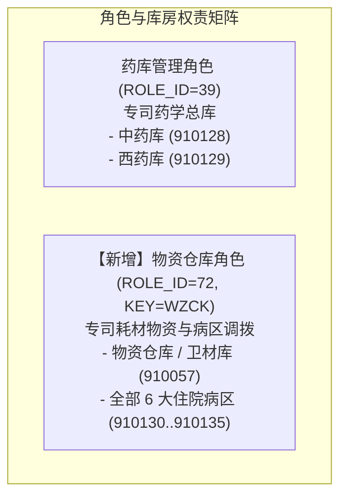
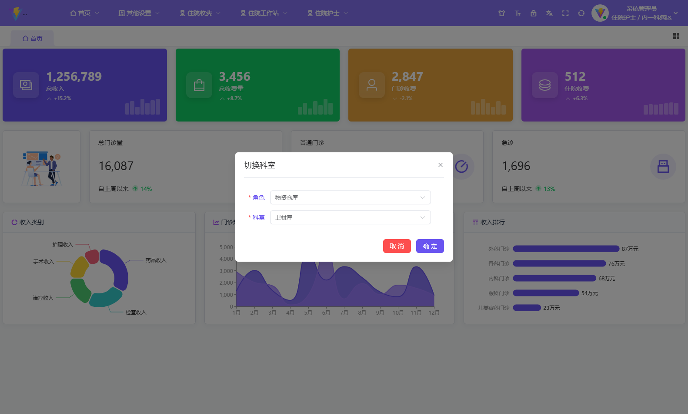
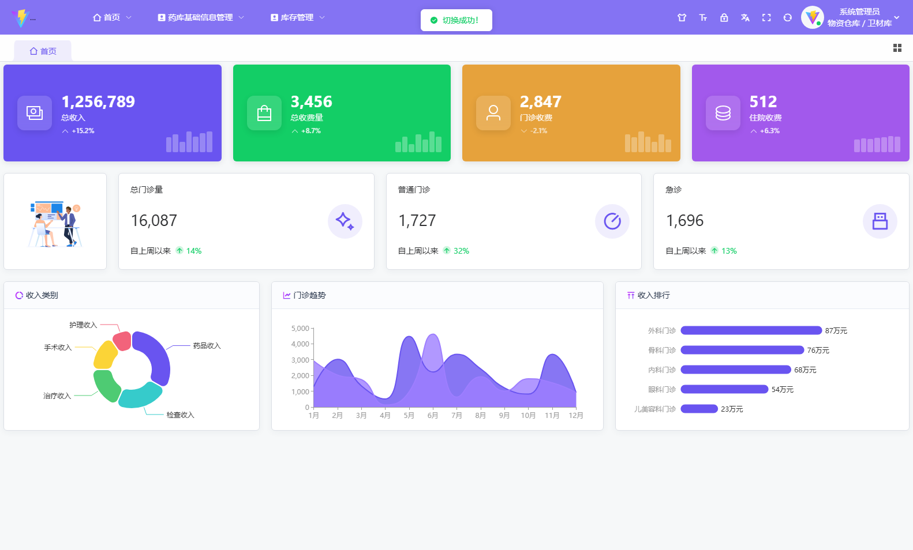
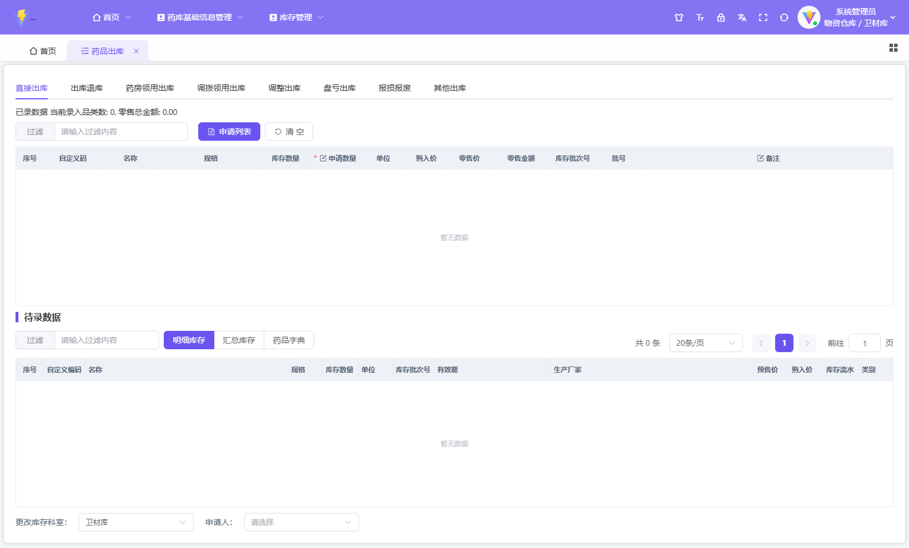
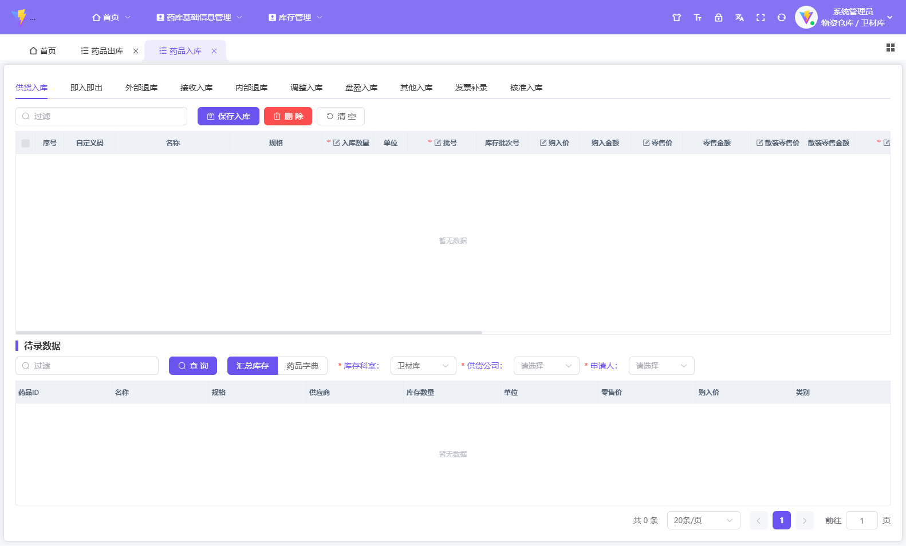

# 专属【物资仓库】角色创建与全病区流转权限验收报告

## 1. 架构调整与角色设计

根据业务规划，物资/耗材体系与药品体系彻底解耦，不再复用“药库管理”，而是建立专门的独立角色：

---

## 2. 数据库配置与赋权实施清单

| 配置环节 | 目标数据表 | 变更明细 | 业务效用 |
| :--- | :--- | :--- | :--- |
| **专属角色定义** | `SYS_ROLE` | 插入记录 `ROLE_ID = 72`，`ROLE_NAME = '物资仓库'`，`ROLE_KEY = 'WZCK'` | 建立一级专属业务角色，支持后续独立定制菜单 |
| **菜单功能继承** | `SYS_ROLE_MENU` | 从 `ROLE_ID = 39`（药库管理）复制全部 32 个功能菜单（`/storage`、`drugInStorage`、`drugOutStorage`、`storageInfo` 等） | 现阶段完全继承药库管理全部出入转调界面功能 |
| **人员角色绑定** | `SYS_USER_ROLE` | 为管理员 `USER_ID = 1` 分配 `ROLE_ID = 72`（物资仓库） | 使管理员具备以物资仓库角色登录与操作资格 |
| **管辖库房分配** | `SYS_USER_ROLE_DEPT` | 插入 7 条科室关联（卫材库 `910057` + 6 大病区 `910130..910135`） | 管理员在物资仓库角色下可自由切换卫材库与各病区 |
| **转入转出业务权限** | `SYS_USER_ROLE_DEPT_PERMISSION` | 为 7 个科室各插入 19 项业务权限（共 133 条，含调拨出库 `10015`、调拨入库 `10004`、领药/领用出库 `10014`/`10017` 等） | 赋予全套物资入库、出库、调拨、退库、报损等动作权限 |
| **药库角色纯净化** | `SYS_USER_ROLE_DEPT` | 从【药库管理】（Role 39）清理掉卫材库与病区关联，恢复其中药库、西药库专属职能 | 彻底消除权限重叠，使药学体系与物资体系严格隔离 |

---

## 3. 前端真实 UI 验证与结果

自动化脚本通过真实 CDP 浏览器会话模拟完整操作：

### 3.1 管理员切换【物资仓库】专属角色与科室
- 管理员登录后打开右上角头像 -> 点击【切换科室】。
- 角色下拉框精准列出【**物资仓库**】。
- 选中【物资仓库】后，科室下拉框仅展示物资专属管辖科室：
  - **`卫材库`**（总库）
  - **`骨二科病区`**、**`内一科病区`**、**`康复科病区`**、**`内二科病区`**、**`骨一科病区`**、**`骨三科病区`**（二级分库/病区库）

### 3.2 切换至【物资仓库 + 卫材库】后左侧菜单渲染
- 页面路由正常，左侧侧边栏完整挂载继承自药库管理的 24+ 项功能菜单（包含库存管理、药品入库、药品出库、采购管理、药品调价、药品盘点等）：

### 3.3 出库工作台（转出）功能校验
- 访问路由：`#/storage/drugOutStorage`
- 状态：渲染成功，零 404 拦截。
- 包含子选项卡：`直接出库`、`退库`、`领药出库`、**`调拨出库`**（向各病区调拨）、**`科室领用出库`**（病区直接领用）、`盘亏出库`、`报损报废` 等。

### 3.4 入库工作台（转入）功能校验
- 访问路由：`#/storage/drugInStorage`
- 状态：渲染成功，零 404 拦截。
- 包含子选项卡：`入库`（外部采购）、`随入即出`、`外部退库`、**`调拨入库`**（接收转入）、`内部退库`、`盘盈入库` 等。

