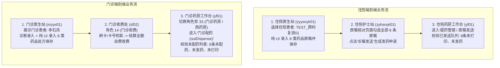
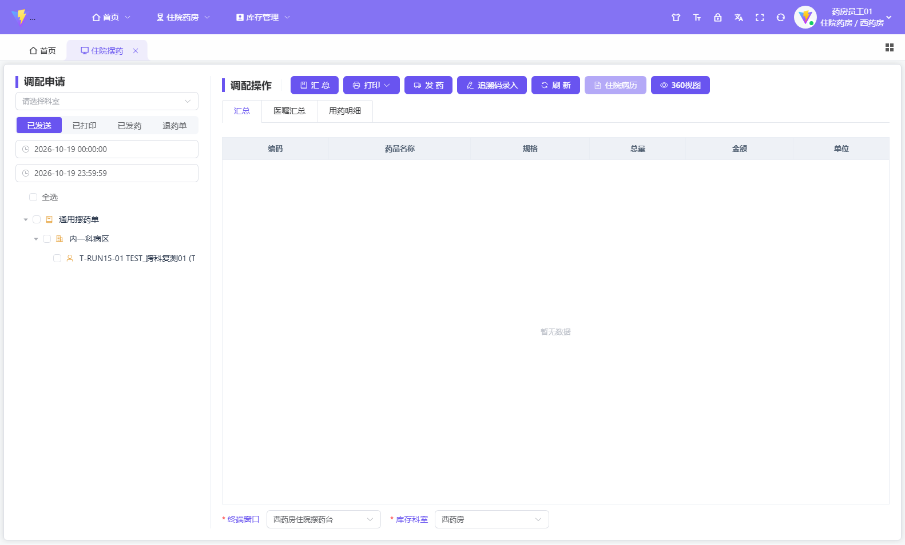
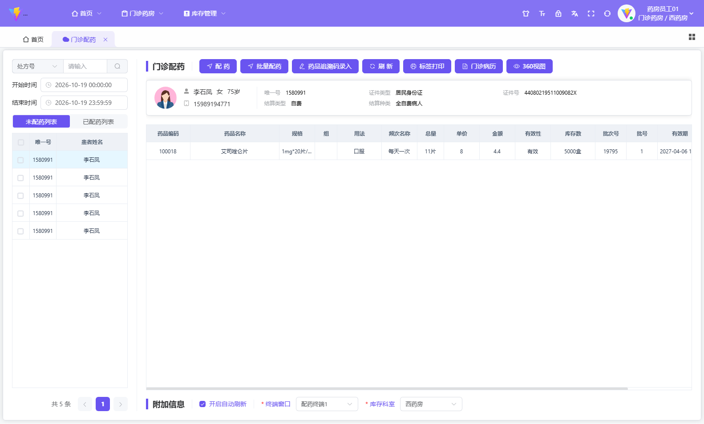

# 通用全流程临床药学端到端（E2E）真实 UI 自动化规范指南

## 1. 核心定位与原则

本规范与通用自动化脚本旨在解决临床药学测试数据生成不真实、依赖底层数据库伪造导致业务状态错位的问题。

> [!IMPORTANT]
> **三大核心原则**：
> 1. **100% 纯前端真实界面点击与键盘事件**：禁止任何针对医嘱/处方表（`MED_IP_ORDER`、`PHA_DISPENSE_APPLY`、`PHA_OP_DISPENSE` 等）的直接 SQL 写入。所有数据必须由真实的医生、护士、收费员、药房人员账号通过浏览器模拟完整产生。
> 2. **八大药品分类全覆盖**：常规口服片剂、口服溶液、常规口服胶囊、外用药品、特管精神药品（精二）、静脉大输液、注射粉针、特管麻醉药品。
> 3. **药房终态对齐**：住院药房到达“已核对发送、未打印、未发药”状态；门诊药房到达“已结算收费、未配药/未发药、未打印”待办队列。

---

## 2. 全流程架构与流转图



---

## 3. 角色、账号与科室矩阵

| 业务场景 | 岗位角色 | 登录账号 | 初始密码 | 目标角色/权限 | 挂载科室 | 核心路由 / 操作界面 |
| :--- | :--- | :--- | :--- | :--- | :--- | :--- |
| **住院** | 住院医生 | `zyysnyk01` | `000000` | 角色 28 (住院医生) | 内一科病区 (910092) | `#/inpatient/order/orderApply` (医嘱录入) |
| **住院** | 住院护士 | `zyhsnyk01` | `000000` | 角色 29 (住院护士) | 内一科病区 (910092) | `#/inpatient/nurse/orderCheck` (医嘱核对与长嘱发送) |
| **住院** | 住院药师 | `yf01` | `000000` | 角色 37 (住院药房) | 西药库房 (380) | `#/pharmacy/dispense/inDispense` (摆药处理) |
| **门诊** | 门诊医生 | `mzys01` | `000000` | 角色 13 (门诊医生) | 内一科门诊 (910127) | `#/outpatient/doctor/doctorStation` (门诊医生站处方开立) |
| **门诊** | 门诊收费 | `sf02` | `000000` | 角色 14 (门诊收费) | 门诊收费处 (100) | `#/outpatient/charge/chargeMain` (门诊结算自费收费) |
| **门诊** | 门诊药师 | `yf01` | `000000` | 角色 33 (门诊药房) | 西药房 (380) | `#/outpatient/pharmacy/outDispense` (门诊配药工作台) |

---

## 4. 八类代表性药品档案与参数

| 序号 | 分类属性 | 代表药品名称 | 拼音码 | 规格 | 频次 | 用法 (UI输入) | 单次剂量/数量 |
| :---: | :--- | :--- | :--- | :--- | :--- | :--- | :--- |
| 1 | **常规口服片剂** | 阿司匹林肠溶片 | `ASPLCRP` | 100mg*30片/盒 | Qd | 口服 | 100mg (1盒/30片) |
| 2 | **口服溶液** | 氨溴特罗口服溶液 | `ABTLKFRY` | 100ml:氨溴索0.3mg*1瓶 | Tid | 口服 | 10ml (1瓶) |
| 3 | **常规口服胶囊** | 奥美拉唑肠溶胶囊 | `AMLZCRJN` | 20mg*14粒/盒 | Qd | 口服 | 20mg (1盒/14粒) |
| 4 | **外用药品** | 阿达帕林凝胶 | `ADPLNJ` | 0.1%(30g:30mg)*1支 | Qn | 外用 | 1g (1支) |
| 5 | **特管精神药品(精二)**| 艾司唑仑片 | `ASZLP` | 1mg*20片/盒 | Qn | 口服 | 1mg (1盒/20片) |
| 6 | **静脉大输液** | 0.9%氯化钠注射液 | `LHNZSY` | 250ml:2.25g*1袋 | Qd | 静脉注射 | 250ml (1袋) |
| 7 | **注射粉针** | 注射用奥美拉唑钠 | `ZSYAMLZN` | 40mg*1支 | Qd | 静脉注射 | 40mg (1支) |
| 8 | **特管麻醉药品** | 枸橼酸芬太尼注射液 | `JYSAFTNZSY`| 0.1mg:2ml*1支 | St | 静脉注射 | 0.1mg (1支) |

---

## 5. 通用自动化工具使用指南

统一执行脚本位于：
[`tools/generate_ui_clinical_pharmacy_data.py`](file:///d:/CSsoft/AI/googleAntiGravity/cliProject/fs_web_testrunner/tools/generate_ui_clinical_pharmacy_data.py)

### 5.1 命令行参数与用法

```bash
# 进入测试运行工程根目录
cd d:/CSsoft/AI/googleAntiGravity/cliProject/fs_web_testrunner

# 1. 执行全量流程 (住院 + 门诊并发或按序完整生成并校验)
python tools/generate_ui_clinical_pharmacy_data.py --mode all

# 2. 仅执行住院全流程 (医生开长嘱 -> 护士审核发送 -> 药房待办验证)
python tools/generate_ui_clinical_pharmacy_data.py --mode inpatient

# 3. 仅执行门诊全流程 (医生开处方 -> 收费结算 -> 药房待配药验证)
python tools/generate_ui_clinical_pharmacy_data.py --mode outpatient

# 4. 调试模式 (开启可见浏览器窗口与自定义测试患者)
python tools/generate_ui_clinical_pharmacy_data.py --mode all --head --inpatient-patient "TEST_跨科复测01" --outpatient-patient "李石凤"
```

### 5.2 状态判定与自动化产出

- **过程控制**：
  - 医生站：医嘱/处方录入后校验 DOM 行数与成功提示（`保存成功` / `提交成功`）。
  - 护士站：核对表格动态查找新增医嘱，全选后触发 `长嘱发送`。
  - 收费处：患者搜索 -> 处方全量载入 -> 自费金额回显（约 691.89 元） -> 结算确认。
  - 药房工作台：检索患者发药记录，核查 `dispenseState == '1'`（未配药/未发药）及 `printFlag == '0'`（未打印）。
- **执行耗时**：全套 16 笔药品处方/医嘱端到端流转约 280 秒。

---

## 6. 自动化验证证据与结果

- 住院药房工作台截图证据：
- 门诊药房配药台截图证据：
